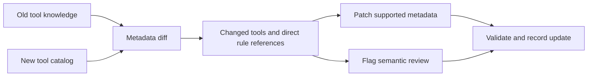

# Selective Patch for Evolving Tool Knowledge

**Hao Qi · Agentic AI research in progress**

Can an agent adapt to changed tools by updating only the affected parts of its tool knowledge, while preserving useful knowledge about everything else?

This repository presents my selective-patch research direction and a small, runnable demonstration. The method compares tool metadata across versions, identifies directly dependent usage rules, updates supported records, and surfaces rules whose meaning needs review. The base language model remains fixed in the proposed agent experiments.

## Research idea

A tool may keep its name while changing its parameters or the structure of its output. Updating its schema alone can leave a downstream instruction referring to a field that no longer exists. Rewriting all knowledge, however, may disturb unrelated instructions. Selective Patch makes the scope of the update explicit and auditable.



The demo uses a synthetic research workflow: a document retrieval tool changes its output from `text` to `content.body`, a citation lookup tool is added, and a note-saving tool stays unchanged. The dependent instruction is flagged for review instead of silently rewritten.

## Run the demonstration

Python 3.10 or later; standard library only. No model service or credentials are needed.

```bash
git clone https://github.com/haoqi016/selective-patch-agent.git
cd selective-patch-agent
python3 selective_patch.py examples/old_knowledge.json examples/new_catalog.json --output /tmp/selective-patch-demo.json
python3 -m unittest discover -s tests -v
```

Expected summary: **1 changed tool, 1 added tool, 1 unchanged tool, and 1 rule requiring review**. Inspect the full [example output](examples/expected_patch.json), including which metadata changed and which rule was affected. Reapplying the patch preserves unresolved review status.

## My contribution

My contribution in the underlying collaborative project is the selective adaptation component: metadata differencing, direct usage-rule dependency tracking, selective record updates, validation, and diagnostics for unsupported semantic changes. I developed the prototype with AI assistance and documented how it connects to the shared adaptation interface.

The shared agent runner, benchmark integration, and baseline infrastructure are collaborative work. This public repository contains a newly written, simplified demonstration and research documentation; it does not distribute the private team's implementation or benchmark catalogs. See [contribution and provenance](docs/contributions.md).

## Evidence and next experiments

| Evidence | What it establishes |
| --- | --- |
| Reproducible synthetic demo and tests in this repository | The demonstrated update logic preserves unrelated records, tracks explicit dependencies, and handles missing tools and unresolved review states. |
| Development observation from the team prototype: task139 Early → Late, 40 → 44 tools; 10 replaced, 4 added, 30 unchanged | The adaptation artifact was generated on real benchmark catalogs. This is an update-mechanism observation, not an agent task-success result. |
| Planned No Update / Full Rewrite / Selective Patch comparison | Will test task recovery, retention, total adaptation and execution cost, and failures from insufficient or excessive updates. Results are pending. |

The historical task139 observation was recorded on 20 October 2026 in the private development report. It cannot be reproduced from the synthetic fixtures here. No improvement in agent performance or comparative cost has yet been established.

## Read further

- [Method and worked example](docs/method.md)
- [Evaluation design and evidence boundaries](docs/evaluation.md)
- [Contribution and provenance](docs/contributions.md)

## Research context

This project builds on the tool-evolution setting studied in Liu et al. (2026), [*MCPEvol-Bench: Benchmarking LLM Agent Performance Across Dynamic Evolutions of MCP Servers*](https://arxiv.org/abs/2607.14642). MCPEvol-Bench is the original authors' benchmark; Selective Patch is my ongoing investigation of adaptation at the tool-knowledge layer. This repository is not an official benchmark implementation or a publication.

The original code and documentation in this repository are released under the [MIT License](LICENSE).
